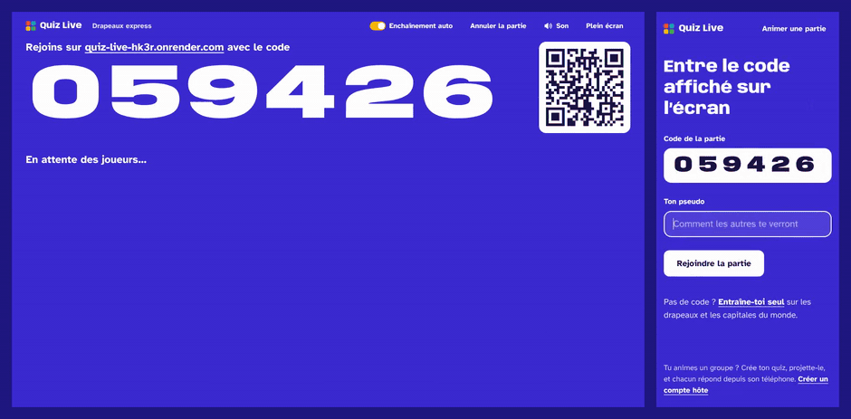
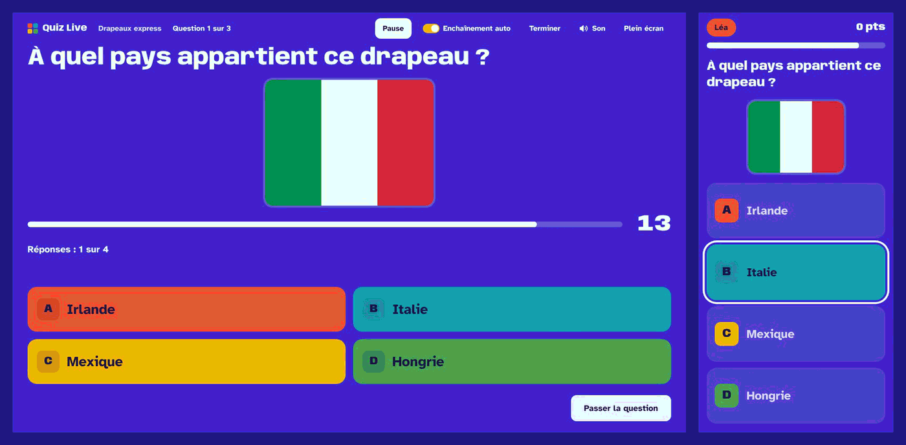
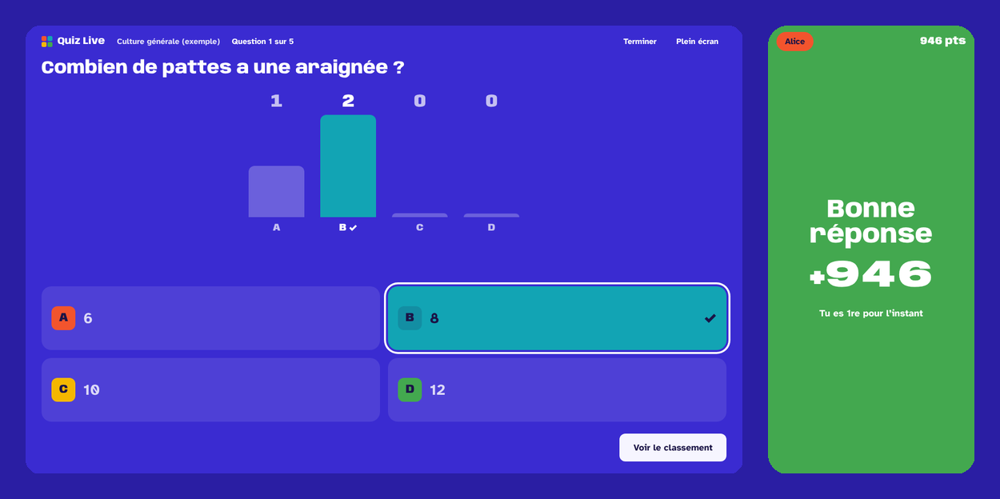
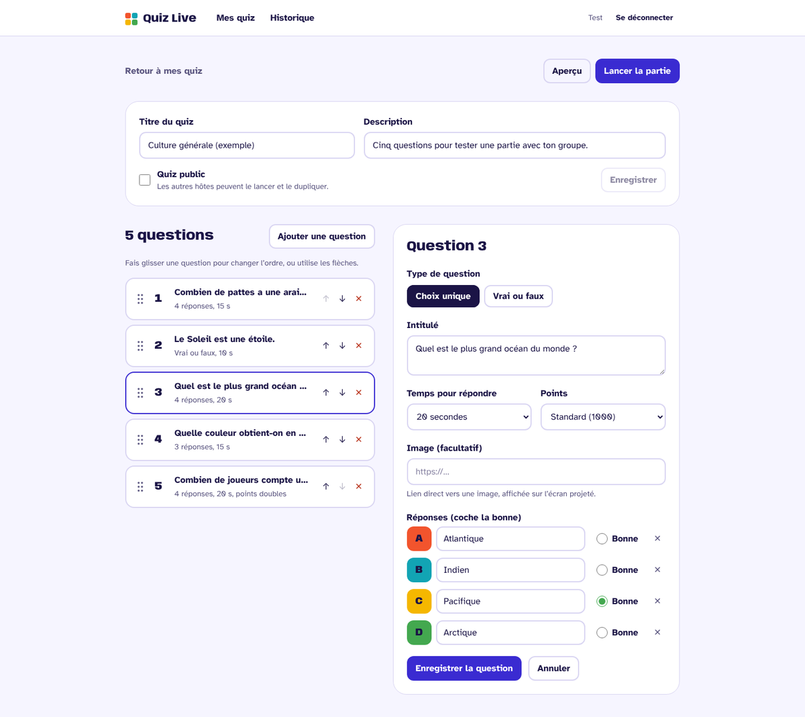
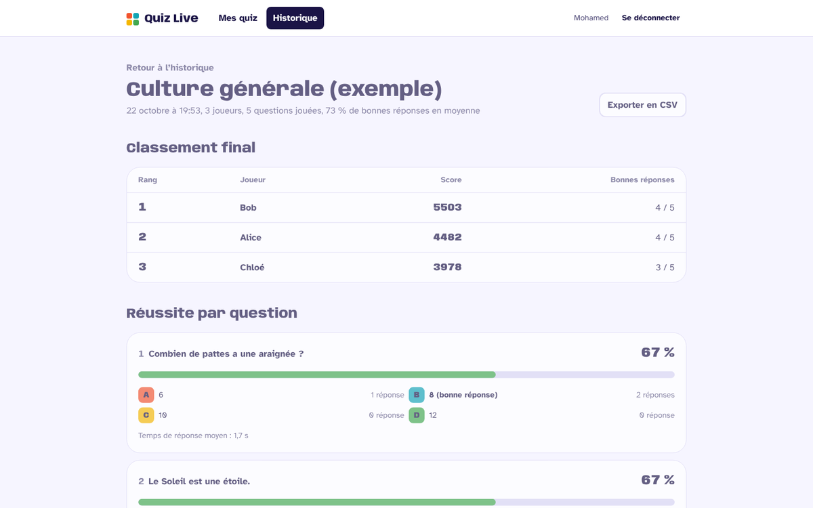
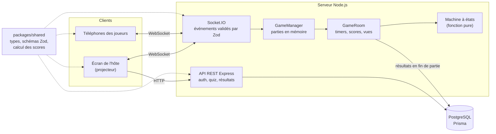
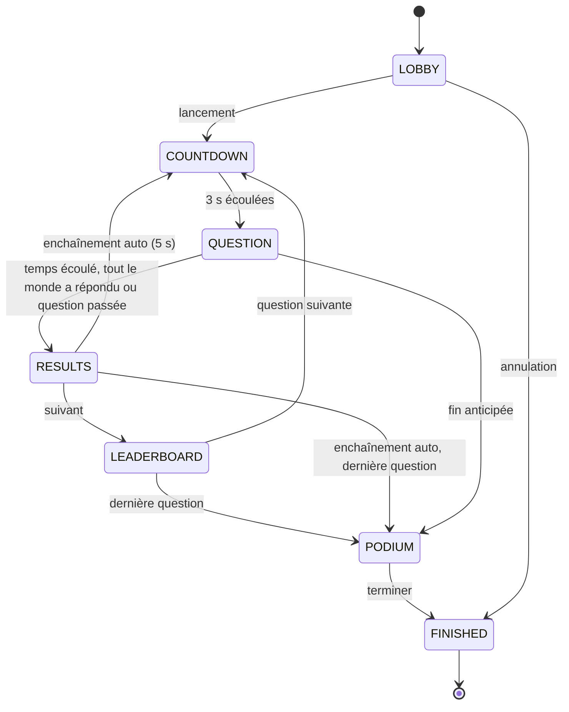
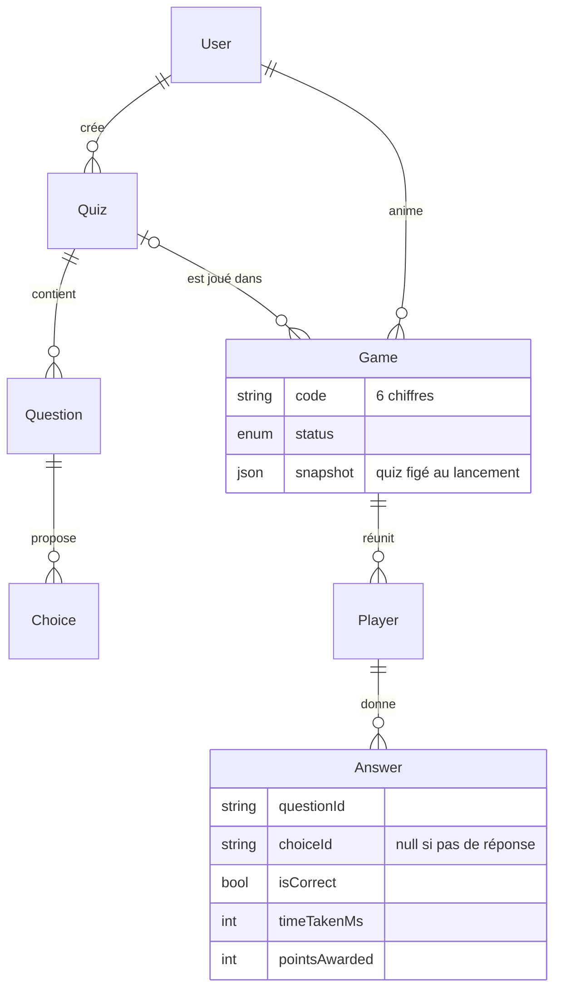

# Quiz Live

Quiz multijoueur en temps réel : l'animateur projette les questions sur grand écran, les joueurs rejoignent avec un code à 6 chiffres et répondent depuis leur téléphone, sans créer de compte. Classement animé après chaque question, podium à la fin, statistiques et export CSV ensuite.

Projet pensé pour animer un groupe (centre de loisirs, classe, soirée, équipe) et conçu comme une vitrine technique : temps réel, logique métier testée, animations soignées et accessibilité.



> **Démo en ligne : <https://quiz-live-hk3r.onrender.com>** (hébergement gratuit : la première ouverture peut prendre une trentaine de secondes, le temps que le serveur se réveille).

## Fonctionnalités

**Hôte (compte requis)**

- Inscription et connexion sécurisées (JWT, mots de passe hachés avec bcrypt).
- Création de quiz : questions à choix unique (2 à 4 réponses) ou vrai/faux, temps de 5 à 60 s, points standard, doubles ou nuls, image facultative.
- Réordonnancement des questions par glisser-déposer (avec une alternative au clavier), duplication de quiz, aperçu avant lancement, quiz d'exemple en un clic.
- **Quiz prêts à jouer** : drapeaux et capitales d'Europe et du monde, avec un drapeau ou une carte de situation pour chaque question. Les pays sont tirés au hasard à chaque partie (en alternant les continents), les mauvaises réponses viennent de la même région et la dernière question compte double. « Jouer maintenant » lance la partie en un clic, « Ajouter à mes quiz » crée une copie modifiable.
- Pilotage de la partie : lobby avec code et QR code, exclusion d'un joueur, pause et reprise, question suivante (bouton ou flèche droite du clavier), fin anticipée, mode plein écran.
- **Enchaînement automatique** : 5 secondes après l'affichage de la bonne réponse, la question suivante démarre seule (un décompte s'affiche sur l'écran projeté et sur les téléphones). L'interrupteur « Enchaînement auto » le désactive pour revenir au rythme manuel, avec classement intermédiaire.
- Historique des parties, classement final, taux de réussite par question, questions les plus ratées et export CSV.

**Joueur (sans compte)**

- Rejoindre avec un code et un pseudo, ou en scannant le QR code.
- Grosses tuiles de réponse lettre + couleur, retour immédiat (bonne réponse, ratée, temps écoulé), points gagnés, place dans l'ordre d'arrivée, série en cours, rang.
- Reprise automatique de la partie après un rechargement de page ou une coupure réseau.

**Entraînement en solo (sans compte)**

- Depuis l'accueil, « Entraîne-toi seul » : les quiz drapeaux et capitales, avec une nouvelle série de pays à chaque fois. Un hôte connecté peut aussi s'entraîner sur ses propres quiz.
- Mode **Apprendre** : pas de chrono, et après chaque réponse la correction avec une phrase à retenir (« Amsterdam est la capitale des Pays-Bas. »).
- Mode **Défi chrono** : temps limité, et plus on répond vite, plus on gagne de points (sans adversaire, la rapidité se mesure au temps mis), avec le même bonus de série qu'en partie.
- Passage automatique à la question suivante 5 s après la correction (ou tout de suite avec Entrée), réponses au clavier (touches 1 à 4), bilan question par question, « Revoir mes erreurs » pour rejouer uniquement les questions ratées, record conservé dans le navigateur.

**Animations**

- Compte à rebours 3, 2, 1 où les chiffres s'étirent grâce à l'axe de largeur variable de la police (timeline GSAP).
- Arrivée des joueurs dans le lobby, barre de temps qui change de couleur, histogramme qui se remplit, classement qui se réordonne (layout animations de Framer Motion), podium qui monte avec confettis.
- Toutes les animations respectent le réglage système « réduire les animations ».

## Captures

| Écran projeté et téléphone pendant une question            | Résultats de la question                            |
| ---------------------------------------------------------- | --------------------------------------------------- |
|  |  |
| **Éditeur de quiz**                                        | **Statistiques après la partie**                    |
|                    |      |

## Stack technique

| Domaine       | Choix                                                                    |
| ------------- | ------------------------------------------------------------------------ |
| Monorepo      | npm workspaces : `apps/web`, `apps/server`, `packages/shared`            |
| Front         | React 19, Vite, TypeScript, React Router, Zustand, Tailwind CSS 4        |
| Animation     | Framer Motion (composants, layout), GSAP (séquences), canvas-confetti    |
| Back          | Node.js, Express 5, TypeScript                                           |
| Temps réel    | Socket.IO                                                                |
| Données       | PostgreSQL, Prisma 7                                                     |
| Validation    | Zod, partagé entre front et back                                         |
| Qualité       | Vitest, Supertest, ESLint, Prettier, Husky + lint-staged, GitHub Actions |
| Documentation | OpenAPI 3.1 / Swagger UI sur `/api/docs`                                 |

## Architecture



- **Le serveur est l'unique source de vérité** : il gère les timers, note les réponses et calcule les scores. Les clients n'affichent que ce qu'ils reçoivent.
- **Un seul événement d'état** (`game:state`) : à chaque transition, le serveur envoie à chaque client une vue adaptée à son rôle. Un joueur qui se reconnecte reçoit simplement l'état courant.
- **La bonne réponse n'est jamais envoyée avant la fin de la question** (vérifié par les tests).
- **Le code partagé** (`packages/shared`) contient les schémas Zod, les types des événements Socket.IO, le calcul des scores et le classement : aucune duplication entre le front et le back.

### Déroulé d'une partie



La machine à états (`apps/server/src/game/state-machine.ts`) est une fonction pure. La salle de jeu (`game-room.ts`) applique les effets : timers, scores, diffusion, persistance. Avec l'enchaînement automatique (activé par défaut), le serveur programme le passage à la question suivante et envoie l'heure prévue (`autoNextAt`) : les clients se contentent d'afficher le décompte.

### Calcul des points

- Bonne réponse : les points dépendent de l'**ordre d'arrivée** des bonnes réponses. Le premier à trouver gagne 100 % de la base, le deuxième 90 %, le troisième 80 %… et jamais moins de 50 %. Sur une question à 1000 points : 1000, 900, 800, 700, 600, puis 500.
- À la fin de chaque question, l'écran projeté affiche les trois plus rapides avec leur temps, et chaque téléphone indique la place du joueur (« 2e plus rapide à trouver »).
- Série : +100 par bonne réponse consécutive à partir de la deuxième, plafonné à +500.
- Mauvaise réponse ou absence de réponse : 0 point, la série repart de zéro.
- Le temps de pause est exclu du temps de réponse : l'ordre d'arrivée reste juste après une pause. Deux réponses dans la même milliseconde partagent la place.
- En entraînement solo (sans adversaire), la rapidité se mesure au temps mis : `base × (1 − (temps mis / temps imparti) / 2)`.
- Égalité de score : le joueur le plus rapide (temps cumulé sur ses bonnes réponses) passe devant.

### Modèle de données



Chaque partie garde un **instantané du quiz** (`Game.snapshot`) : modifier ou supprimer un quiz ne fausse jamais l'historique des résultats.

## Lancer le projet en local

Prérequis : Node.js 22 recommandé (20.19 minimum), Docker (pour PostgreSQL).

```bash
git clone https://github.com/MohamedAlicode/online-quiz.git quiz-live
cd quiz-live
cp .env.example .env            # puis remplace JWT_SECRET par une longue chaîne aléatoire
docker compose up -d            # PostgreSQL + base de test
npm install                     # installe tout et génère le client Prisma
npm run db:migrate              # crée les tables
npm run dev                     # API sur :3001, front sur :5173
```

Ouvre <http://localhost:5173>, crée un compte hôte, ajoute le quiz d'exemple et lance une partie. Pour jouer depuis un téléphone sur le même Wi-Fi, ouvre l'adresse réseau affichée par Vite (par exemple `http://192.168.1.20:5173`) et saisis le code.

La documentation de l'API est disponible sur <http://localhost:3001/api/docs>.

### Scripts

| Commande             | Rôle                                            |
| -------------------- | ----------------------------------------------- |
| `npm run dev`        | Lance le serveur et le front en parallèle       |
| `npm test`           | Tous les tests (unitaires et intégration)       |
| `npm run lint`       | ESLint sur tout le monorepo                     |
| `npm run typecheck`  | Vérification TypeScript de chaque package       |
| `npm run format`     | Formatage Prettier                              |
| `npm run build`      | Build de production du serveur et du front      |
| `npm run db:migrate` | Applique les migrations Prisma en développement |

## Tests

```bash
docker compose up -d   # les tests d'intégration utilisent la base quiz_test
npm test
```

- **Calcul des scores, classement, schémas Zod** (`packages/shared`) : tests unitaires purs.
- **Machine à états et salle de jeu** : déroulé complet, pause, déconnexions, exclusion, fin anticipée, et vérification que la bonne réponse ne fuit jamais. Les timers sont simulés (`vi.useFakeTimers`), donc les tests sont rapides et déterministes.
- **API REST** (Supertest) : authentification, droits d'accès entre hôtes, CRUD, réordonnancement, duplication.
- **Scénario temps réel complet** : un hôte et deux vrais clients Socket.IO jouent une partie, avec reconnexion d'un joueur, puis les résultats et l'export CSV sont vérifiés via l'API.
- **Front** : synchronisation d'horloge et utilitaires.

La CI GitHub Actions lance le formatage, le lint, le typage, les tests (avec un PostgreSQL de service) et le build à chaque push et pull request.

## Choix techniques

- **Monorepo avec un package partagé** : les schémas Zod valident les formulaires côté front ET les requêtes côté serveur. Une règle (par exemple « exactement une bonne réponse ») n'existe qu'à un seul endroit.
- **Logique de jeu isolée de Socket.IO et de Prisma** : `GameRoom` reçoit un transport et un système de persistance injectés. On la teste avec des faux objets, sans réseau ni base de données.
- **État complet plutôt qu'une suite d'événements** : chaque client reçoit la vue complète de la phase en cours. La reconnexion devient triviale et le front reste un simple « afficheur ».
- **Horloge synchronisée** : chaque état contient l'heure du serveur. Le client calcule son décalage et tous les écrans affichent le même compte à rebours, même si l'horloge d'un téléphone est fausse.
- **Persistance en fin de partie, dans une transaction** : la partie se joue en mémoire (rapide), puis joueurs, réponses et classement sont écrits en une fois, tout ou rien.
- **Sécurité** : mots de passe hachés, message d'erreur identique pour un email inconnu ou un mauvais mot de passe, limitation de débit sur l'authentification et les événements Socket.IO, en-têtes Helmet, protection contre l'injection de formules dans l'export CSV.
- **Accessibilité** : chaque réponse a une lettre en plus de sa couleur, contrastes vérifiés, navigation au clavier (y compris pour réordonner les questions), annonces pour les lecteurs d'écran, animations réduites si demandé.
- **Performance côté joueur** : les écrans de l'hôte sont chargés à la demande, ceux du joueur (accueil, partie) sont dans le bundle principal.

## Déploiement

En production, **un seul service** sert l'API, Socket.IO et le front React à la même adresse : pas de CORS à configurer, et le WebSocket passe par la même origine que la page.

1. **Base de données** : crée un projet PostgreSQL gratuit sur [Neon](https://neon.tech) et copie l'URL de connexion **directe** (option « Connection pooling » désactivée), qui sert aussi aux migrations.
2. **Application sur [Render](https://render.com)** : « New > Blueprint », sélectionne ce dépôt (le fichier `render.yaml` est détecté) et colle l'URL Neon dans `DATABASE_URL`. `JWT_SECRET` est généré automatiquement et les migrations sont appliquées à chaque démarrage.

L'image se construit depuis la racine : `docker build -f apps/server/Dockerfile -t quiz-live .`

> Sur l'offre gratuite de Render, le service se met en veille après 15 minutes sans visite : la première ouverture peut prendre une trentaine de secondes.

**Variante front séparé** : le front peut aussi être déployé sur Vercel (`apps/web` comme « Root Directory », variable `VITE_API_URL` pointant vers le serveur). Il faut alors renseigner l'URL du front dans `CLIENT_ORIGIN` côté serveur.

## Limites et pistes d'amélioration

- Les parties actives sont en mémoire : une seule instance du serveur. Pour passer à plusieurs instances, il faudrait partager l'état (Redis et l'adaptateur Redis de Socket.IO).
- Le jeton de l'hôte est stocké dans le `localStorage` ; un cookie `httpOnly` serait plus robuste face au XSS.
- Le mode entraînement reçoit les bonnes réponses avec les questions et se corrige dans le navigateur : sans classement ni enjeu, la triche n'a pas d'intérêt, et cela évite tout aller-retour réseau. Les parties en direct, elles, restent corrigées par le serveur.
- Prévu ensuite : questions à choix multiple et à réponse libre, mode équipes, import de quiz en CSV, d'autres quiz prêts à jouer (monuments, langues), sons.

## Crédits

- Drapeaux : [flag-icons](https://github.com/lipis/flag-icons) (licence MIT).
- Cartes de situation : générées par `scripts/generate-quiz-images.ts` à partir de [@svg-maps/world](https://github.com/VictorCazanave/svg-maps) (licence CC BY 4.0, Victor Cazanave).
- Polices : Anybody et Atkinson Hyperlegible (SIL Open Font License).

## Organisation du dépôt

```
apps/
  server/   API Express, Socket.IO, moteur de jeu, Prisma
  web/      application React (hôte et joueurs)
packages/
  shared/   schémas Zod, types, calcul des scores et du classement
docs/       captures et GIF de démonstration
scripts/    génération des images des quiz prêts à jouer
```

Le cahier des charges complet est dans [SPEC.md](SPEC.md) et les conventions du projet dans [CLAUDE.md](CLAUDE.md).

## Auteur

**Mohamed Ali Ouachani**, développeur web. Bachelor Administrateur des Systèmes d'Information (option développement web) à H3 Hitema.
